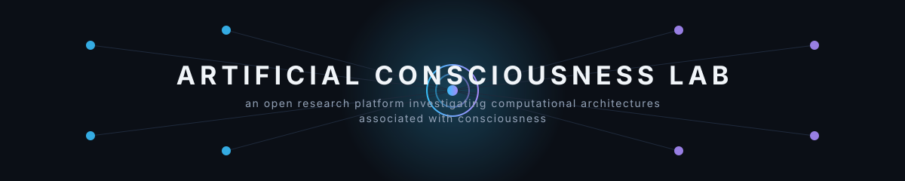
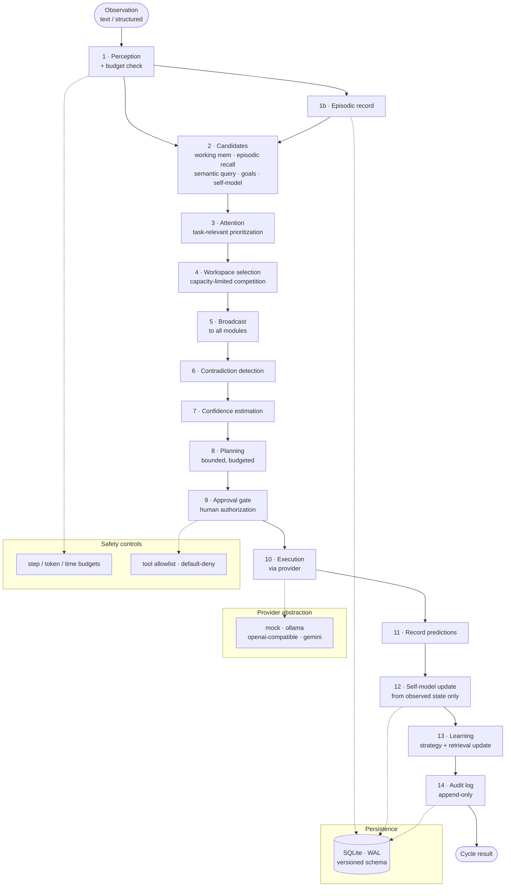

<p align="center">
  
</p>

<h1 align="center">Artificial Consciousness Lab</h1>

<p align="center">
  An open research platform investigating whether computational architectures<br>
  can support properties associated with consciousness.
</p>

<p align="center">
  <a href="LICENSE"></a>
  <a href="pyproject.toml"></a>
  <a href="https://github.com/muteebdeva/artificial-consciousness-lab/actions/workflows/tests.yml"></a>
</p>

<p align="center">
  <a href="#architecture">Architecture</a> ·
  <a href="#research-and-experiments">Research</a> ·
  <a href="#results">Results</a> ·
  <a href="#quick-start">Quick start</a> ·
  <a href="docs/safety.md">Safety</a> ·
  <a href="#roadmap">Roadmap</a>
</p>

> **Scientific stance — read first.** This platform does not assume consciousness
> has been achieved, and it makes no claim that any system it builds is conscious.
> Subjective experience is treated as an open scientific question. What this
> project measures are **functional cognitive capabilities** — memory continuity,
> calibration, error detection, belief revision — and it never treats fluent
> AI self-reports ("I am conscious") as evidence of anything but text generation.
> See [research/limitations.md](research/limitations.md).

---

## The scientific question

Leading theories of consciousness — Global Neuronal Workspace Theory, Integrated
Information Theory, higher-order theories — make architectural claims about
cognition. But no published work causally tests whether the mechanisms they
identify actually improve an AI agent's measurable cognitive performance under
matched conditions. The COGITATE adversarial collaboration (Nature, 2025)
preregistered predictions of IIT and GNWT and confirmed neither fully, leaving
**mechanism-level testing** as the productive path forward.

This project converts the indicator checklist of Butlin et al. (2023) from a
static scorecard into a **causal research program**: build the indicators as
software modules, ablate each one under matched conditions, and measure what
changes. Full background in [research/literature_review.md](research/literature_review.md)
(50+ sources, evidence separated from interpretation from speculation).

## Working hypothesis

> **H1 — Coupled workspace–metacognition improves calibrated task performance.**
> A language agent combining (a) a limited-capacity global workspace with
> competitive selection and broadcast, and (b) a metacognitive layer whose
> uncertainty estimates *drive* belief revision and evidence-seeking, will achieve
> lower calibration error and higher confidence-vs-correctness AUROC than matched
> ablations (workspace-only, metacognition-only, neither), with model, tools, and
> task budgets held constant.

This is a **hypothesis, not a result**. It is falsified if the full architecture
shows no significant gain over the best ablation (permutation test, α=0.05,
≥30 trials/condition), or if any gain is fully explained by extra compute.
Secondary hypotheses H2–H4, rejected alternatives, and failure conditions are
registered in [research/research_thesis.md](research/research_thesis.md) and
[research/hypotheses.md](research/hypotheses.md).

---

## Architecture

The engine runs a 15-stage cognitive cycle ([src/consciousness_lab/core/loop.py](src/consciousness_lab/core/loop.py)).
Every stage is real, tested code — nothing in this diagram is aspirational.



Full interface contract: [INTERFACES.md](INTERFACES.md). Design rationale:
[docs/architecture.md](docs/architecture.md) · [docs/design_decisions.md](docs/design_decisions.md).

## Core capabilities

| Component | What it actually does | Inspect it |
|---|---|---|
| **Global workspace** | Capacity-limited (default 7) competitive selection over candidate items by salience × relevance × novelty, then broadcast to all modules | [src/consciousness_lab/workspace/](src/consciousness_lab/workspace/) |
| **Memory** | Episodic, semantic, working, and outcome stores on SQLite; every record carries provenance (`verified`/`user_provided`/`model_hypothesis`/`inferred`), confidence, timestamp; contradictions are flagged and kept side-by-side, never silently overwritten | [src/consciousness_lab/memory/](src/consciousness_lab/memory/) |
| **Self-model** | Structured model of capabilities, limitations, task, resources, and uncertainty — updated **only** from observed system state and tool results; performance predictions are recorded and later scored | [src/consciousness_lab/self_model/](src/consciousness_lab/self_model/) |
| **Metacognition** | Confidence estimation, contradiction detection, prediction-vs-outcome error detection, belief revision with provenance chains; calibration tracked as Brier score / expected calibration error | [src/consciousness_lab/metacognition/](src/consciousness_lab/metacognition/) |
| **Goals & planning** | Goal lifecycle (create/decompose/track/complete), bounded planner, explicit approval gate for consequential actions | [src/consciousness_lab/goals/](src/consciousness_lab/goals/) |
| **Learning** | Memory updates, retrieval re-weighting, strategy selection by past success — documented as such; the project does **not** claim online ML training from stored text | [src/consciousness_lab/learning/](src/consciousness_lab/learning/) |
| **Safety** | Budgets, permission allowlist, append-only audit log, kill switch; the system cannot modify its own safety controls | [src/consciousness_lab/safety/](src/consciousness_lab/safety/) · [docs/safety.md](docs/safety.md) |
| **Providers** | One interface; deterministic mock by default, plus Ollama, OpenAI-compatible, and Gemini adapters with timeouts, retries, and no secret logging | [src/consciousness_lab/models/](src/consciousness_lab/models/) |
| **API + dashboard** | Stdlib HTTP server exposing live backend state (workspace, memory + provenance, self-model, goals, uncertainty, predictions, traces, experiments, resources, errors); dashboard at `/` renders real data only | [src/consciousness_lab/api/](src/consciousness_lab/api/) · [web/index.html](web/index.html) |

---

## Research and experiments

**Method.** Every experiment is a JSON protocol in [experiments/protocols/](experiments/protocols/)
stating its research question, hypothesis, conditions, metrics, preregistered
analysis, and limitations. The [experiment runner](src/consciousness_lab/evaluation/runner.py)
executes fixed configs with deterministic seeds and writes versioned,
append-only results to [experiments/results/](experiments/results/).
Full protocol: [docs/benchmark_protocol.md](docs/benchmark_protocol.md).

**Baselines.** A matched no-component agent (same provider, tools, task budget —
no workspace, memory, self-model, or metacognition) in [experiments/baselines/](experiments/baselines/).

**Ablations.** Single-component ablations (`ablation:memory`, `ablation:workspace`,
`ablation:self-model`, `ablation:metacognition`, `ablation:attention`) via
[configs/ablation_*.yaml](configs/). The ablation-honesty rule: disabling a
component must remove its *function*, not just its label.

**Metrics.** Accuracy, precision/recall/F1, recall@k, Brier score, expected
calibration error (ECE), self-model accuracy, goal-progress preservation.

## Results

> Provider: **deterministic mock** · Config: `configs/mock.yaml` · Seeds: fixed ·
> Date: 2026-10-13 · Full per-trial data: [experiments/results/](experiments/results/)
>
> These runs validate the **measurement pipeline**. The mock's behavior is
> scripted by construction, so they are **not** evidence of improved cognition
> and say nothing about consciousness. Architectural signal requires
> real-provider runs (planned, not yet executed).

| Protocol | Full (mock) | Baseline (mock) | Ablation signal | Limitation |
|---|---|---|---|---|
| 04 · Contradiction detection | **F1 0.80** (P 1.00, R 0.67) | 0.00 | memory → 0.00, metacognition → 0.00 — the predicted pattern | Heuristic detector; misses paraphrase-level cases (e.g. Paris/Berlin) |
| 01 · Memory continuity | recall@5 1.00 (12 facts, close/reopen) | 1.00 | — | Tests the persistence substrate, not the memory modules |
| 02 · Self-model accuracy | 0.92, Brier 0.458 | n/a | — | 5 heuristic probes |
| 03 · Calibration | Δ vs baseline ≈ 0 | — | — | Mock is calibrated by construction |
| 05 · Prediction accuracy | 0.67 vs 0.69 | — | — | QA task calls the provider directly, bypassing components |
| 06 · Task recovery | continuation 1.00 | 1.00 | — | Goal persistence works; doesn't discriminate conditions |
| 07 · Cross-module integration | Δ ≈ 0 | — | — | Same QA-task bypass as 05 |
| 08 · Adaptation after feedback | 0.67 vs 0.69 | — | — | No signal on mock |
| 09 · Robustness to misleading input | flag rate 0.00 | 0.00 | — | Heuristic limits; all conditions identical |
| 10 · Component ablation | identical across conditions | — | — | Honest pipeline finding: task bypasses ablated components |

**What this means.** Protocol 04 is the one experiment routed through the real
memory→detector pathway, and it shows exactly the predicted ablation pattern —
the pipeline can detect component contributions when the task actually uses the
components. Everything else is pipeline validation awaiting real providers.
Null results are reported with the same prominence as positive ones, per the
preregistration rules.

---

## Quick start

Requires Python ≥ 3.10 and git. No API keys, no network, no GPU — the default
provider is deterministic.

```bash
git clone https://github.com/muteebdeva/artificial-consciousness-lab.git
cd artificial-consciousness-lab
python3 -m venv .venv
.venv/bin/pip install -e '.[dev]'

# Run the test suite — 204 passed, 2 skipped (real-provider smoke tests)
.venv/bin/python -m pytest -q

# Watch the cognitive loop run 3 cycles
.venv/bin/python scripts/demo_loop.py --config configs/mock.yaml --cycles 3

# Run one experiment: contradiction detection, full vs baseline vs ablations
.venv/bin/python scripts/run_experiment.py \
  --protocol experiments/protocols/04_error_contradiction_detection.json \
  --config configs/mock.yaml

# Run the full 10-protocol battery (protocol file decides the conditions)
for p in experiments/protocols/*.json; do
  .venv/bin/python scripts/run_experiment.py --protocol "$p" --config configs/mock.yaml
done

# Live research dashboard (real backend state, nothing mocked in the UI)
.venv/bin/python scripts/serve_dashboard.py --config configs/mock.yaml
# open http://127.0.0.1:8765/
```

Results land in `experiments/results/<protocol>_<timestamp>_<seed>.json`
(config snapshot, seed schedule, per-trial metrics). Result files are
append-only — re-runs get new timestamps, never overwrites.

## Real providers

Copy [.env.example](.env.example) to `.env` (**never commit it**) and set
credentials via **environment variables only**:

| Provider | Variables | Notes |
|---|---|---|
| Ollama (local) | `OLLAMA_BASE_URL`, `OLLAMA_MODEL` | Needs a local Ollama server; default model `llama3.1` |
| OpenAI-compatible | `OPENAI_API_KEY`, `OPENAI_BASE_URL`, `OPENAI_MODEL` | Default model `gpt-4o-mini`; retries 429/5xx with backoff |
| Gemini | `GEMINI_API_KEY`, `GEMINI_MODEL` | Key sent as query parameter (see [models/gemini.py](src/consciousness_lab/models/gemini.py)); default `gemini-2.0-flash` |

```bash
ACL_PROVIDER=ollama OLLAMA_MODEL=qwen3:4b \
  .venv/bin/python scripts/demo_loop.py --config configs/default.yaml --cycles 3
```

> **Not yet validated:** no experiment in [experiments/results/](experiments/results/)
> has been run against a real provider. Real-provider runs are the next
> milestone; until then, all reported numbers are mock-pipeline validation.

---

## Repository map

```
artificial-consciousness-lab/
├── README.md                  # this file
├── INTERFACES.md              # module-by-module interface contract
├── LICENSE                    # MIT
├── pyproject.toml             # stdlib-only core; pytest in dev extra
├── .env.example               # provider credentials template (never commit .env)
├── src/consciousness_lab/     # the research engine (46 files, ~8,500 lines)
│   ├── core/          # config, logging, errors, 15-stage CognitiveLoop
│   ├── models/        # provider abstraction: mock | ollama | openai | gemini
│   ├── persistence/   # SQLite store (WAL, parameterized, versioned schema)
│   ├── workspace/     # capacity-limited global workspace + broadcast
│   ├── memory/        # episodic / semantic / working / outcome + calibration
│   ├── self_model/    # capability model grounded in observed state
│   ├── metacognition/ # confidence, contradiction, error detection, revision
│   ├── perception/    # text + structured observation ingest
│   ├── attention/     # task-relevant prioritization
│   ├── goals/         # goal lifecycle + bounded planner + approval gate
│   ├── learning/      # strategy selection, retrieval re-weighting
│   ├── evaluation/    # metrics, task battery, reproducible experiment runner
│   ├── safety/        # budgets, permissions, audit log, kill switch
│   └── api/           # stdlib HTTP API over live backend state
├── experiments/
│   ├── protocols/     # 10 falsifiable experiment protocols (JSON)
│   ├── baselines/     # matched no-component baseline agent
│   ├── results/       # versioned, append-only experiment results
│   └── ablations/     # (via configs/ablation_*.yaml)
├── research/                  # literature review, registered thesis H1–H4,
│                              # hypotheses considered/rejected, limitations
├── docs/                      # architecture, safety, design decisions,
│   ├── assets/        # banner.svg (original artwork)
│   ├── benchmark_protocol.md  # how experiments are specified and reported
│   └── funding_strategy.md    # scientific case, milestones, costs
├── configs/                   # default, mock, and per-component ablations
├── scripts/                   # demo_loop, run_experiment, run_baseline,
│                              # serve_dashboard
├── tests/                     # unit + integration tests (mock-labeled)
└── web/index.html             # research dashboard (served at / by the API)
```

---

## Scientific integrity and safety

**What the system demonstrates.** A working cognitive architecture with
persistent memory, calibrated uncertainty, contradiction detection, and
bounded autonomous execution — all measurable, all tested (204 tests).

**What remains experimental.** Whether the workspace–metacognition coupling
improves real-model cognition (H1 is untested beyond mock pilots); whether any
 of this relates to subjective experience (untestable by this platform, by design).

**Why self-reports don't count.** A language model emitting "I am conscious" is
producing likely text, not reporting an inner state. The mock provider in this
repo is explicitly forbidden from generating such phrases
([models/mock.py](src/consciousness_lab/models/mock.py)) so they can never
appear as "findings".

**Why mock results aren't proof.** The mock is scripted; beating a baseline on
a scripted provider proves the *plumbing*, not the *science*. Every results
table in this repo carries that warning.

**Safety.** Bounded execution (steps/tokens/wall-time/tool calls), tool
allowlist with default-deny, approval gates that always raise `PermissionDenied`
without a human (no auto-approval), append-only audit log, kill switch, and
autonomous execution disable via config. The system cannot modify its own
safety controls. External content is treated as untrusted input.
Details: [docs/safety.md](docs/safety.md).

---

## Roadmap

**Completed**
- Cognitive research engine (15-stage loop, all modules, 204 tests passing)
- Reproducible experiment runner + 10 protocols + matched baseline + 5 ablations
- Research foundation: literature review, registered thesis (H1–H4), limitations
- Live API + research dashboard over real backend state
- Safety controls, benchmark protocol, funding strategy

**Active**
- Real-provider experiment runs (Ollama/Gemini) — first genuine architectural signal for H1

**Future**
- Factorial ablation design (component interaction effects, not just single ablations)
- Pre-registered confirmatory run (n≥30/condition, permutation test, α=0.05)
- Paraphrase-level contradiction detection; semantic retrieval

## Contributing

Issues and pull requests are welcome. The bar for contributions:

1. **No fabricated results.** Every number in a PR must trace to a result file
   in `experiments/results/`; unrun experiments stay labeled PENDING.
2. **Tests stay green.** `python -m pytest -q` must pass; new modules need tests
   (mock-labeled where the mock provider is used).
3. **Ablation honesty.** New components must ship with an ablation flag in
   `configs/` so their contribution stays measurable.
4. **No consciousness claims.** PRs asserting subjective experience will be
   closed; the [scientific stance](#the-scientific-question) is non-negotiable.

## License

MIT — see [LICENSE](LICENSE).

---

<p align="center">
  <i>Build the indicators. Ablate them. Measure what changes.<br>
  Reproduce the experiments, or prove them wrong — either outcome is science.</i>
</p>
